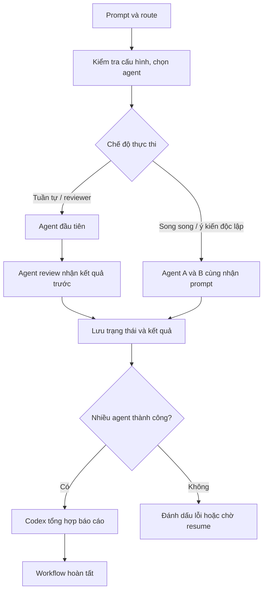

# Personal AI Team

Personal AI Team là bộ điều phối workflow nhiều agent chạy trên máy cá nhân. Codex là agent chính để điều phối và tổng hợp; Antigravity có thể nghiên cứu hoặc phản biện; Ollama là lựa chọn chạy model cục bộ. Dự án dùng Python, lưu trạng thái workflow thành tệp JSON và không tự commit hay merge Git.

## Mục lục

- [Yêu cầu](#yêu-cầu)
- [Cài đặt](#cài-đặt)
- [Chạy nhanh](#chạy-nhanh)
- [Chọn route và chế độ chạy](#chọn-route-và-chế-độ-chạy)
- [Quản lý workflow](#quản-lý-workflow)
- [Đưa tệp dự án vào ngữ cảnh](#đưa-tệp-dự-án-vào-ngữ-cảnh)
- [Cấu hình](#cấu-hình)
- [Dữ liệu, riêng tư và phục hồi](#dữ-liệu-riêng-tư-và-phục-hồi)
- [Kiểm thử](#kiểm-thử)
- [Cấu trúc thư mục](#cấu-trúc-thư-mục)

## Yêu cầu

- Python 3.10 trở lên.
- Cài các CLI agent bạn định dùng và bảo đảm chúng có trong `PATH`:
  - Codex CLI: lệnh `codex`.
  - Antigravity CLI: lệnh `agy`.
  - Ollama: lệnh `ollama` và model đã tải về.
- Codex cần được cài và bật nếu workflow có nhiều agent, vì Codex tạo báo cáo tổng hợp cuối.

Ollama là tùy chọn. Cấu hình mặc định dùng model `llama3.2`; tải model một lần bằng:

```powershell
ollama pull llama3.2
```

Ứng dụng chỉ kiểm tra model cục bộ, không tự tải model khi chạy workflow.

## Cài đặt

Mở PowerShell tại thư mục dự án:

```powershell
python -m venv .venv
.\.venv\Scripts\Activate.ps1
python -m pip install -r requirements.txt
```

Nếu PowerShell chặn kích hoạt môi trường ảo, có thể gọi Python trong môi trường trực tiếp:

```powershell
.\.venv\Scripts\python.exe -m pip install -r requirements.txt
```

Trên macOS/Linux, lệnh kích hoạt tương ứng là `source .venv/bin/activate`.

## Chạy nhanh

Chạy một câu hỏi đơn giản qua route mặc định (`simple_questions`, dùng Codex):

```powershell
python -m orchestrator.main run "Giải thích cấu trúc của dự án này"
```

Chạy qua menu tương tác:

```powershell
python -m orchestrator.main
```

CLI cũng có trợ giúp cho từng lệnh:

```powershell
python -m orchestrator.main --help
python -m orchestrator.main run --help
python -m orchestrator.main doctor
```

`doctor` kiểm tra các CLI agent đang bật có trong `PATH` và đọc được phiên bản qua `--version`. Có thể cấu hình đối số khác bằng `version_args` trong `config/agents.yaml`. Adapter báo lỗi theo nhóm dễ nhận biết như thiếu executable, timeout, lỗi khởi chạy hoặc mã thoát khác 0; nội dung cụ thể của output vẫn tùy CLI bên thứ ba.

## Chọn route và chế độ chạy

Route mô tả loại công việc và agent cần tham gia. Danh sách route mặc định:

| Route | Agent theo thứ tự | Cách dùng |
|---|---|---|
| `simple_questions` | Codex | Hỏi đáp thông thường; có thể chọn tuần tự hoặc song song nếu route có nhiều agent. |
| `technical_research` | Antigravity → Codex | Nghiên cứu rồi để Codex xem xét/tổng hợp. |
| `coding` | Codex → Antigravity | Codex xử lý, Antigravity phản biện kết quả. |
| `architecture` | Codex → Antigravity | Đề xuất kiến trúc, sau đó review. |
| `debugging` | Codex → Antigravity | Phân tích lỗi, sau đó review. |
| `code_review` | Codex | Review mã nguồn. |

Ví dụ dùng route:

```powershell
python -m orchestrator.main run "Nghiên cứu lựa chọn lưu trữ cho ứng dụng nhỏ" --route technical_research
python -m orchestrator.main run "Tìm nguyên nhân lỗi đăng nhập" --route debugging
```

Có thể chọn agent trực tiếp thay vì route:

```powershell
python -m orchestrator.main run "Đề xuất ba tên cho ứng dụng" --agent codex
python -m orchestrator.main run "Tóm tắt phương án này" --agent antigravity
python -m orchestrator.main run "Tóm tắt văn bản bằng model cục bộ" --agent ollama
```

`--agent both` chạy Codex và Antigravity. Mặc định chúng chạy tuần tự; chọn `--parallel` để chạy đồng thời:

```powershell
python -m orchestrator.main run "So sánh hai phương án triển khai" --agent both --parallel
```

Trong chế độ song song, mỗi agent nhận cùng prompt ban đầu và không nhận kết quả của agent kia. Chọn tuần tự khi agent sau cần xem hoặc phản biện kết quả trước:

```powershell
python -m orchestrator.main run "Đề xuất và review kiến trúc" --route architecture --sequential
```

Sơ đồ luồng:



Các route có reviewer được cấu hình chạy tuần tự, để reviewer nhận kết quả trước. Không thể ghi đè route cần review bằng `--parallel`. Route `either` cho phép chọn bằng `--parallel` hoặc `--sequential`. Chế độ mặc định toàn cục nằm trong `config/routing.yaml`.

## Quản lý workflow

Mỗi lần chạy tạo một workflow ID. Dùng lệnh `status` để xem các workflow gần đây:

```powershell
python -m orchestrator.main status
python -m orchestrator.main status --limit 20
```

Xem một workflow cụ thể bằng ID mà lệnh `run` đã in ra:

```powershell
python -m orchestrator.main status WF-202611120001
```

Task text được ẩn mặc định trong status. Chỉ hiển thị khi chủ động yêu cầu:

```powershell
python -m orchestrator.main status WF-202611120001 --show-task
```

Trạng thái bao gồm trạng thái từng agent, số lần thử, thời gian chạy, lỗi và đường dẫn báo cáo nếu có. Chi phí/token có thể hiện `unknown` vì các adapter hiện không cung cấp thống nhất số liệu này.

Nếu tiến trình dừng giữa chừng, tiếp tục workflow:

```powershell
python -m orchestrator.main resume WF-202611120001
```

Có thể bỏ ID khi chỉ có đúng một workflow cần phục hồi:

```powershell
python -m orchestrator.main resume
```

Nếu có nhiều workflow đủ điều kiện, CLI sẽ liệt kê ID để bạn chọn. Resume dùng kết quả đã hoàn tất và chạy lại phần còn thiếu theo trạng thái đã lưu. Các lần thử lại tự động được điều khiển bởi `max_retries` trong `config/routing.yaml`.

Xem trước dữ liệu workflow cũ sẽ được dọn:

```powershell
python -m orchestrator.main prune --older-than-days 30
```

Đây là chế độ preview, không xóa dữ liệu. Khi đã xem danh sách và muốn xóa các workflow đã kết thúc cùng artifact không được workflow khác dùng, chạy:

```powershell
python -m orchestrator.main prune --older-than-days 30 --apply
```

Lệnh prune không xóa log append-only toàn cục `logs/agent_runs.log`.

## Đưa tệp dự án vào ngữ cảnh

Khi prompt nhắc rõ đường dẫn tệp tương đối trong workspace, orchestrator có thể đọc nội dung tệp đó và thêm vào prompt cho agent. Ví dụ:

```powershell
python -m orchestrator.main run "Đọc README.md và đề xuất phần hướng dẫn còn thiếu"
python -m orchestrator.main run "Tìm lỗi trong orchestrator/main.py và giải thích nguyên nhân"
```

Chỉ các phần mở rộng văn bản được hỗ trợ mới được đọc. Đường dẫn phải nằm trong workspace; tệp vượt giới hạn kích thước/ngữ cảnh, khớp mẫu tên nhạy cảm hoặc có dấu hiệu secret phổ biến trong nội dung sẽ bị bỏ qua. Bộ quét nhận diện private key, một số token/API key phổ biến và biến như `password`, `api_key` hoặc `access_token` có giá trị. Đây là bộ lọc heuristic; không thể đảm bảo phát hiện mọi định dạng bí mật. Mặc định giới hạn là 60.000 byte mỗi tệp và 100.000 ký tự tổng cộng. Nội dung tệp được xem là dữ liệu đầu vào không đáng tin cậy.

## Cấu hình

Các tệp cấu hình chính:

| Tệp | Điều khiển |
|---|---|
| `config/agents.yaml` | Tên lệnh, model tùy chọn, vai trò và bật/tắt agent. |
| `config/routing.yaml` | Agent theo route, thứ tự review, chế độ tuần tự/song song, giới hạn agent và số lần retry. |
| `config/policies.yaml` | Timeout, chính sách ngữ cảnh, lọc tên tệp, giới hạn workspace và trường được ghi vào log. |

Một phần `config/routing.yaml` mặc định:

```yaml
execution:
  mode: sequential        # Mặc định tuần tự
  allow_parallel: true    # Cho phép chọn --parallel
  max_agents_per_task: 2
  max_retries: 1          # Một lần thử thêm sau lần đầu
```

`max_agents_per_task` là nguồn cấu hình giới hạn số agent cho mỗi workflow. `max_retries: 1` nghĩa là tối đa hai lần gọi agent khi lần đầu thất bại: lần đầu và một lần thử thêm.

## Dữ liệu, riêng tư và phục hồi

Workflow và kết quả được lưu dưới dạng văn bản có thể đọc được:

| Vị trí | Nội dung |
|---|---|
| `state/workflows/*.json` | Prompt, trạng thái workflow/agent và thông tin phục hồi. |
| `results/` | Kết quả agent và báo cáo tổng hợp `FINAL-WORKFLOW-<id>.md`. |
| `logs/agent_runs.log` | Nhật ký append-only của các lần chạy. |

Mặc định log không ghi prompt, output thô, diagnostics hay structured result. Tuy nhiên prompt vẫn nằm trong state và kết quả/báo cáo vẫn nằm trong `results/`. `status` ẩn task text theo mặc định; `--show-task` sẽ hiển thị lại. Vì vậy, hãy coi workspace là nơi chứa dữ liệu task và đầu ra agent. Các thư mục runtime này không được Git theo dõi theo `.gitignore`; chúng vẫn tồn tại cục bộ cho đến khi được dọn thủ công hoặc qua `prune --apply`.

State lock tuần tự hóa cập nhật trạng thái và ghi log; workflow lease phối hợp giữa các tiến trình CLI để ngăn hai tiến trình cùng chạy/resume một workflow. Lease được giải phóng khi tiến trình kết thúc. Sau crash, workflow có thể được tiếp tục bằng `resume`.

## Kiểm thử

Chạy toàn bộ bộ kiểm thử:

```powershell
python -m unittest discover -s tests -v
```

GitHub Actions chạy bộ test trên Windows, macOS và Ubuntu với Python 3.10–3.12 khi push hoặc mở pull request.

## Phạm vi triển khai

Đây là công cụ cục bộ cho một người dùng, không phải dịch vụ nhiều người dùng. Workflow lưu trong filesystem của workspace và được bảo vệ bằng khóa file cho các tiến trình cục bộ; không có đăng nhập, phân quyền người dùng, database server hay telemetry tập trung. Không chia sẻ cùng thư mục state qua network filesystem hoặc giữa người dùng không tin cậy. Nếu cần triển khai nhóm, cần thiết kế riêng tầng API có xác thực/phân quyền, kho lưu trữ giao dịch và quan sát tập trung thay vì mở trực tiếp workspace này lên mạng.

## Cấu trúc thư mục

```text
config/          Cấu hình agent, route và policy
orchestrator/    CLI, điều phối, adapter, state, recovery và retention
tests/           Kiểm thử đơn vị và tích hợp
agents/          Hướng dẫn vai trò agent
skills/          Quy trình tái sử dụng
memory/          Ghi chú/memory của dự án
projects/        Khu vực dự án làm việc
state/           Trạng thái workflow runtime (được Git ignore)
results/         Đầu ra agent và báo cáo (được Git ignore)
logs/            Nhật ký runtime (được Git ignore)
```
